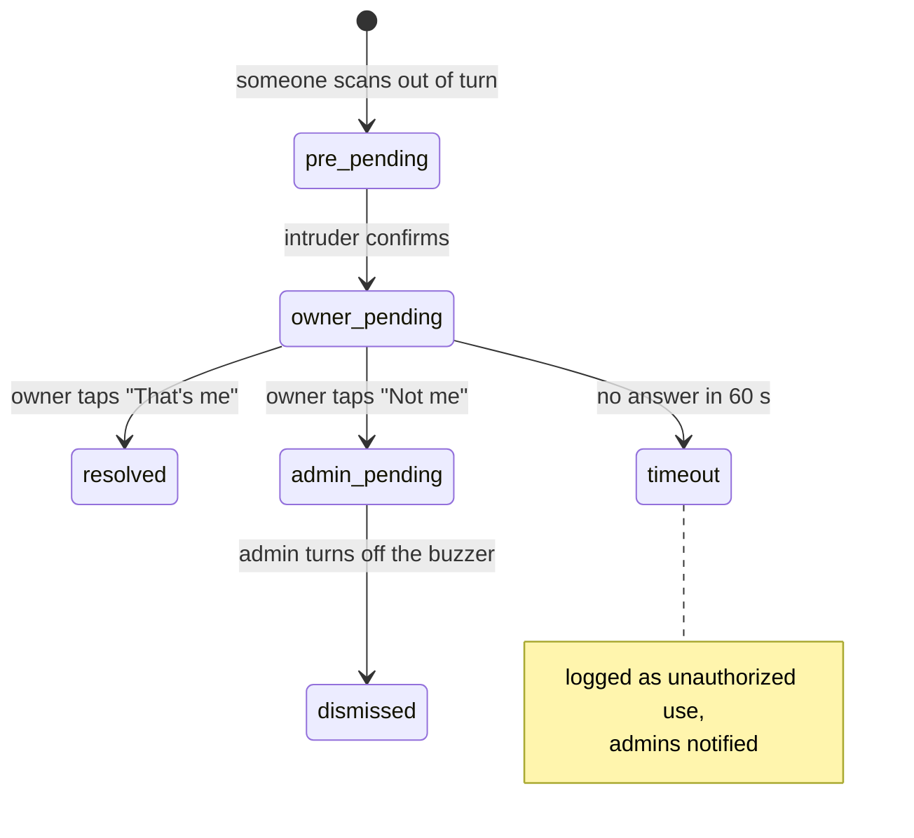

# Laundrix Backend

Serverless API for [Laundrix](https://github.com/ngweibin050-dev/Laundrix), the smart laundry IoT system. It runs on Vercel's free tier and owns everything that must not be decided on a phone: who gets the machine, queue order, grace-period expiry, unauthorized-use incidents and push notifications.

**Live:** [laundrix-backend.vercel.app](https://laundrix-backend.vercel.app) · TypeScript · Firebase Admin SDK · Vercel serverless functions

## Endpoints

To stay inside Vercel's 12-function free-tier limit, related operations share one endpoint and are selected with an `action` field.

| Endpoint | Actions | What it does |
| --- | --- | --- |
| `POST /api/scan` | – | QR scan at a machine. Results: `authorized`, `queue_empty_claim`, `already_current`, `unauthorized`, `machine_not_found` or `user_not_found`. Unauthorized scans create an incident and notify the owner and admins; authorized scans unlock the machine and record the session start |
| `POST /api/queue` | `join`, `leave` | Join or leave a machine's queue. Uses Firestore transactions and an idempotency key so double taps can't add a user twice; starts the 5-minute grace period when the user is first in line and the machine is free |
| `POST /api/release` | – | Ends a session: checks the caller is the current user, writes the usage record (start, end, duration), frees the machine and notifies the next user |
| `POST /api/grace-actions` | `claim`, `dismiss-alarm`, `collect-clothes`, `start-clothes` | Claim your turn, silence the alarm, and the "collect your clothes" grace period |
| `POST /api/incident-action` | `confirm`, `thats_me`, `dismiss`, `confirm_not_me`, `admin_dismiss`, `admin_dismiss_false`, `timeout` | Staged unauthorized-use flow (below) |
| `POST /api/grace-timeout` | – | Grace-period warning/expiry; called only by the cron job |
| `GET /api/cron` | – | Runs every minute: expires grace periods once (removing no-shows from the queue) and times out incidents the owner didn't answer (logged as unauthorized use, admins notified). Requires `x-cron-secret` |
| `POST /api/notify` | `type: call` / `type: chat` | Push notifications for incoming, missed, cancelled and ended calls and for chat messages |
| `POST /api/livekit-token` | – | Issues a LiveKit access token so two users can join a voice or video call room |
| `POST /api/admin` | `cleanup-queue`, `user-deleted` | Removes deleted users from all queues |
| `GET /api/warmup` | – | Opens Firestore and Realtime Database connections so the first real request isn't slow |

### Unauthorized-use incidents



Signals reach each person's phone through a per-user `incidentSignals/{uid}` document. Firestore rules stop regular users from querying the shared `incidents` collection, so each person only sees their own signal.

### Why the cron job owns expiry

Earlier, every phone in the queue called `grace-timeout` when a countdown hit zero, so a user could be removed several times at once. Now only the server cron expires grace periods. It runs once per expiry, so the queue is updated exactly once.

## Notifications

`lib/fcm.ts` sends Firebase Cloud Messaging pushes on high-priority Android channels and also stores every notification in Firestore for the in-app history. Events include: your turn, grace warning, removed from queue, unauthorized alert/warning, buzzer triggered, clothes ready, session started/ended, queue joined, chat message, and incoming/missed calls.

## Security

- **Done:**
  - Firebase Admin credentials, the LiveKit secret and the cron secret come only from Vercel environment variables.
  - Ownership checks on state-changing actions: only the current user can release a machine, only the right user can claim a grace period or dismiss an alarm.
  - `/api/cron` requires `x-cron-secret`.
- **Not yet done:** the endpoints don't verify a Firebase ID token. They trust the `userId` in the request body, so someone who knows another user's ID could act as them, and `/api/admin` is open. The fix is to require `Authorization: Bearer <ID token>` on every endpoint, check that the token's uid matches `userId`, check the admin role for `/api/admin`, and send the token from the app's `apiCall` helper. CORS is also set to `*` in `vercel.json` and should be limited to the app's origins.

## Setup

```bash
npm install
# create .env.local with the variables below
npx vercel dev                  # http://localhost:3000
npm run type-check
```

| Variable | Purpose |
| --- | --- |
| `FIREBASE_PROJECT_ID`, `FIREBASE_CLIENT_EMAIL`, `FIREBASE_PRIVATE_KEY`, `FIREBASE_DATABASE_URL` | Firebase Admin service account and Realtime Database |
| `LIVEKIT_API_KEY`, `LIVEKIT_API_SECRET` | Voice/video call tokens |
| `CRON_SECRET_KEY` | Protects `/api/cron` |

`FIREBASE_PRIVATE_KEY` must keep its `\n` line breaks and be wrapped in quotes. Deploy with `vercel --prod`, set the same variables in **Project → Settings → Environment Variables**, and schedule `GET /api/cron` every minute with the `x-cron-secret` header.

## Project layout

```
api/     one file per endpoint (Vercel functions)
lib/     firebase.ts (Admin init), queue.ts, grace.ts, fcm.ts, cors.ts, types.ts
```
